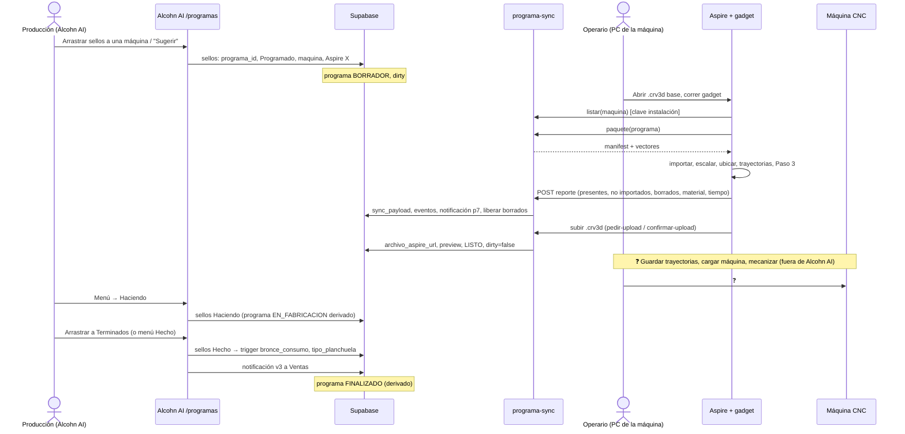

# WF-04 · Programa y fabricación CNC

## Variante con preparación visual (DB/edge publicadas; gadget y prueba conectada pendientes)

Armar programa → **Preparar programa** → verificar soporte/material y plantillas → mover, dimensionar y elegir receta por ejecución → **Guardar preparación** (chequeo de todos los SVG y revisión nueva) → gadget 3.2 **Sincronizar y recalcular** → resolver solo conflictos de la misma propiedad → comprobar geometría real y auxiliares → informe recalculado + archivo del mismo resultado/revisión → revisar trayectorias y guardar TXT → Haciendo. Si falta material, devolver el sello a pendientes y guardar antes del sync. Informe/archivo viejos no aprueban un plan nuevo; tampoco aprueban otro resultado de la misma revisión. Principales con capas automáticas; perfilados finos y perímetro manuales admitidos solo en sus campos específicos, con selección antes de cada recálculo individual. Se mantienen los parámetros nativos confirmados de C (Q-PROG-020/022). [Alcance y controles](../02-modules/programas/preparacion-visual.md).

| | |
|---|---|
| **Inicio** | Hay sellos vectorizados elegibles (panel "Vectores" en Programas; badge del menú si hay urgentes). |
| **Actores** | Fede: arma el programa en Alcohn AI, opera Aspire y las dos CNC. |
| **Módulos** | Programas, gadget de Aspire / `programa-sync`, Producción, Notificaciones, Stock (bronce) |
| **Resultado** | Sellos en `Hecho`, programa `FINALIZADO`, consumo de bronce registrado, Ventas notificada. |

## Diagrama

✅ Calificación local 2026-10-16: armado de ocho SVG ficticios descargado desde el editor → instrumento local → Aspire 10.514, copia C → quince trayectorias recalculadas → corrección interna nativa + movimiento/escala desde una segunda revisión de la app → cero reimportaciones → vista previa de todas las trayectorias. No se ejecutó CNC ni se escribieron estados/archivos en el servidor. [Evidencia](../audits/programas-aspire-real-2026-10-16.md).

✅ Continuación local: informe nativo r2 → **Leer informe de Aspire** → chequeo del SVG real en el editor → nueva posición Y=-240/r3 → Aspire conserva ocho dibujos, recalcula trece trayectorias y deja dos sellos con repaso/seis sin repaso → informe r3 leído en la app, sin observaciones. Un informe anterior se rechaza sin reemplazar el actual. Este intercambio mediante archivos no ejecuta el transporte al servidor ni aprueba estados de fabricación.

## Pasos

1. **Armar** (Programas):
   - Arrastrar un sello a un bolsillo vacío (crea programa con nombre automático y fecha de hoy) o a un programa existente; o abrir la hoja → **+** → filtrar por planchuela → **Sugerir** (prioridad + antigüedad, hasta llenar planchuelas).
   - Validaciones: máquina admite la planchuela del sello; no superar el largo máximo por planchuela.
   - Criterio confirmado: prioritarios → más viejos → aprovechar la planchuela; un programa por día por máquina.
2. **Chequear la fresa** (opcional, recomendado): hoja → **Fresa** (o clic derecho → Chequear fresa) muestra qué sellos tienen lugares donde la fresa no llega y permite corregirlos y guardar el vector nuevo → [chequeo-de-fresa](../02-modules/vectorizacion/chequeo-de-fresa.md).
3. **Llevar a Aspire**:
   - Preferido: en la PC de la máquina, abrir el `.crv3d` base y correr el gadget → elige el programa de la lista (baja el paquete solo).
   - Alternativa sin internet: **Descargar** el ZIP en Alcohn AI, descomprimir, correr el gadget eligiendo la carpeta.
4. **Gadget** (ver [gadget-aspire.md](../02-modules/programas/gadget-aspire.md)): modo Armar/Actualizar/Rehacer/Solo recalcular; importa SVG/DXF; rechaza EPS; pregunta por sellos faltantes; recalcula; reporta; sube el `.crv3d`.
5. **Resultado en Alcohn AI**: hoja en **Listo para Fabricar**, preview 2D, alertas (no importados, otra planchuela, sobrantes). Sellos que el operario borró por falta de material vuelven a la cola (`motivo_salida_programa='SIN_MATERIAL'`).
   - **Trabajo manual confirmado después del gadget** (Q-PROG-016/017/018, 2026-10-15): Fede ajusta vectores, chequea medidas y revisa cómo queda con la fresa llamada «0,5 mm» (configurada como 0,6 mm, 15° laterales). Donde falta detalle usa la de punta 0,1 mm: solo una parte si no toca el resto; si toca, amplía la selección a las partes necesarias, pudiendo incluir todo el sello. El repaso fino llega a 0,6 mm también en Alimento; profundidad principal Clásico 1,7 mm, 3 mm/Alimento a 3 mm, Alimento con corte perimetral de fresa de 6 mm. El estado LISTO actual no acredita que esa revisión se haya hecho.
6. **Fabricar** (externo, confirmado): guardar trayectorias en pendrive, cargarlas en la CNC, colocar planchuelas precortadas, dejar corriendo (→ Haciendo), cortar y probar en cuero (→ Hecho). El armado con mango/varilla lo hace Cachi al despachar → [FR-04](../10-operational-boundaries/README.md#fr-04), [SOP fabricar un sello](../11-operations-sops/fabricar-un-sello.md).
7. **Registrar avance**: menú del programa → **Haciendo**; al terminar arrastrar a **Terminados** (todos `Hecho`) o, desde la vista lista, revisar sello por sello (Hecho/Retocar/Rehacer). También se puede marcar por sello en Producción/Pedidos.
8. **Efectos de `Hecho`** (✅): trigger `registrar_bronce_consumo_sello` (cada vez que un ítem `SELLO` entra a `Hecho`; si se rehace y vuelve a `Hecho`, registra otro consumo) guarda largo y costo de bronce y fija `tipo_planchuela`; notificación v3 "N sellos terminados" a Ventas; el programa pasa a `FINALIZADO` cuando todos sus sellos están `Hecho`/`Verificar`.

## Cambios de estado

| Momento | Sello | Programa |
|---|---|---|
| Agregar | `Programado`, `Aspire X`, máquina | `BORRADOR`, `dirty` |
| Paquete/gadget OK | — | `LISTO` |
| Haciendo | `Haciendo` | `EN_FABRICACION` (derivado) |
| Terminado | `Hecho` | `FINALIZADO` (derivado) |
| Falla | `Rehacer` (+prioridad) | vuelve a no finalizado |
| Sacado por material | estado previo, `SIN_MATERIAL` | cantidad recalculada |

## Excepciones

- Vector `.eps` → no entra al Aspire; hay que re-vectorizar el sello (Camino A de WF-03) y correr **Actualizar**.
- Prioritario de último momento: se agrega al programa aunque ya se haya descargado (no hay bloqueo automático) y se corre **Actualizar**.
- Programa con candado: no se puede editar; los cambios de estado sí.
- Marcar `Rehacer` desde el menú del programa **no** pide motivo (a diferencia de Pedidos/Producción). El equipo quiere que lo pida (POL-016, pendiente).

## Preguntas

[Q-PROG-*](../14-open-questions/programas.md), [Q-CNC-*](../14-open-questions/produccion-fabricacion.md).
