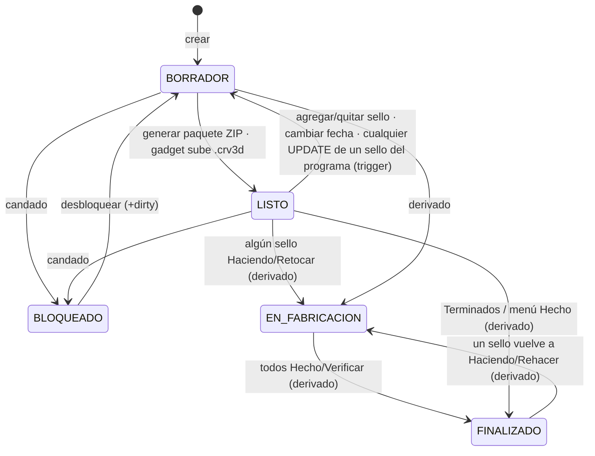

# Máquina de estados — Programa (`programa.estado_programa`)

**Variante de preparación visual (migración aplicada/verificada el 2026-10-16, edge v31 publicada, gadget/prueba conectada pendientes):** guardar una revisión y recibir un informe nuevo dejan `dirty=true` y `LISTO → BORRADOR`. El informe recalculado sin errores actualiza `revision_sincronizada`; confirmar un archivo existente de esa misma revisión y del último evento de resultado fija `archivo_revision`, limpia `dirty` y habilita `LISTO`. Descargar el ZIP no cambia el estado. El inicio `Haciendo` se controla en DB mediante revisión/archivo/informe y contenido vigente, sin depender del `dirty` legado que se modifica durante la cascada de estados. Ver [detalle](../02-modules/programas/preparacion-visual.md).

Valores (CHECK): `BORRADOR`, `LISTO`, `BLOQUEADO`, `EN_FABRICACION`, `FINALIZADO`. Flags: `bloqueado`, `dirty`, `verificado`.

| Estado | Etiqueta UI | Significa | Entrada |
|---|---|---|---|
| `BORRADOR` | Borrador | Armándose o cambió desde el último paquete | Crear, editar, desbloquear |
| `LISTO` | **Listo para Fabricar** | Paquete generado o `.crv3d` subido por el gadget | `markProgramPackageReady`, edge `confirmar-upload` |
| `BLOQUEADO` | candado | Congelado manualmente | `lockProgram` |
| `EN_FABRICACION` | En fabricación | Hay sellos en `Haciendo`/`Retocar` | Derivado |
| `FINALIZADO` | Finalizado | Todos los sellos `Hecho`/`Verificar` | Derivado; va a "Terminados" |

## Cómo se calcula

`deriveLifecycleFromStamps(base, bloqueado, stamps)` en el navegador: candado > sin sellos > todos terminados > alguno en curso > estado guardado. `getPrograms()` **persiste** `EN_FABRICACION`/`FINALIZADO` si difieren (escritura como efecto de leer).

## `dirty`

✅ Control local 2026-10-16: para `BORRADOR → LISTO` se exige el evento del último resultado nativo, no solo la revisión. Otro informe con la misma revisión invalida el archivo; una confirmación atrasada se rechaza en la RPC bajo el mismo bloqueo que registrar/guardar. Un reintento de evento ya procesado no revierte un resultado nuevo ni limpia `dirty`. El trigger de inicio sigue exigiendo revisión/archivo/informe vigentes.

"Desactualizado desde la última descarga": `true` al crear, editar o desbloquear; `false` al generar el paquete o recibir el `.crv3d` del gadget. La alerta se muestra solo si además hay ZIP generado.

## Interacciones peligrosas

En programas con preparación, la comprobación de auxiliares (`execution.verified` y versión vigente) se exige junto con recálculo sin errores, archivo de la revisión y contenido actual antes de iniciar. Un informe antiguo que solo declare recálculo no habilita fabricación.

- El trigger `mark_programa_dirty_on_sello_relevant_update` marca `dirty` y devuelve `LISTO → BORRADOR` ante **cualquier** UPDATE de un sello que sigue en el programa, incluido pasarlo a `Haciendo`/`Hecho`. En la práctica el estado derivado lo tapa, pero `estado_programa` guardado y `dirty` quedan en valores que no reflejan "cambió el contenido". → [AUD-INC-008](../audits/inconsistencias.md#aud-inc-008).
- Un sello sacado a `Sin Hacer` desde Producción sigue con `programa_id` y el programa no se entera por la vía normal.

## En la mesa de armado (2026-10-20)

Etapas visibles: Armado → Revisado → En Aspire → Para fabricar → **Fabricando** (algún sello `Haciendo`, botón «Empezar a fabricar») → Fabricado (botón «Marcar fabricado»). Un fabricado queda en la mesa 2 días desde el último paso a `Hecho` (`estado_historial`) y después solo en el historial. Ver [módulo](../02-modules/programas/README.md#fabricación-y-archivo-en-la-mesa-2026-10-20).

**2026-10-26:** el inicio (`Haciendo`) ya no exige el archivo de Aspire de la revisión; queda pendiente y se avisa en la mesa. Un programa puede quedar en **Fabricando** con parte de los sellos `Hecho` y el resto `Haciendo` («Falta repaso»). Ver [módulo](../02-modules/programas/README.md).
